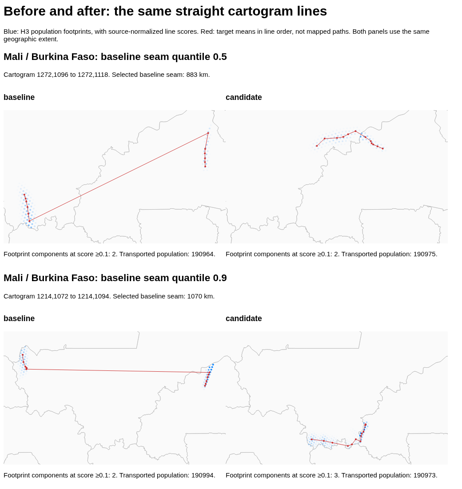

# Border continuity: findings

Date: 2026-10-11.

## Result

There is a useful local result, but no whole-planet solution yet.

The fine Mali–Burkina Faso fit brings border distances close to nearby internal
distances. It keeps the country outlines and source populations. Larger tests
still have large gaps and more reversed triangle area. Do not replace the
production fit with these research fits.

Some limits come from the target artwork, not from Sinkhorn. The artwork joins
countries that are far apart geographically. Sparse border populations impose
another limit, even where countries are true neighbours.

## Best matched result

This test uses the existing H3-5 source population and subdivision 3. It has
4,826 country-labelled source rows and 2,871 target cells. Both plans use the
same inputs and temperature. Distances are in kilometres.

| Measure | Baseline | Candidate |
| --- | ---: | ---: |
| Border RMS over all edges | 906.9 | **53.4** |
| Nearby internal RMS over all edges | 52.8 | **49.6** |
| Border RMS median | 878.4 | 50.2 |
| Nearby internal RMS median | 39.9 | 38.9 |
| Border RMS 90th percentile | 1,069.0 | 74.9 |
| Nearby internal RMS 90th percentile | 68.6 | 75.9 |
| Maximum border RMS | 1,090.1 | 81.4 |
| Border mean-position gap, median | 878.6 | 41.9 |
| Nearby internal mean-position gap, median | 20.1 | 26.5 |
| Mean source spread | 19.8 | 18.0 |
| Maximum source spread | 321.2 | 256.7 |
| Maximum internal mean-position gap | 361.0 | 536.2 |

The RMS calculation uses the full source distributions, not only their means.
Thus the improvement is not just two blurred means moving together. Nearby
internal RMS decreases, as do mean spread, spread tails, and maximum spread.

There are limits. The largest internal mean-position gap increases. Reversed
triangle area falls from 317.5 to 91.7 km², but the count rises from 5 to 15.
This triangle test is a geometric diagnostic, not proof of an invertible map.

The maximum relative source-mass error is `5.0e-15`. The largest target-mass
error is 0.032%. The per-country target L1 error is at most `2.8e-5`.

[Full audit](continuity-runs/mali-final-audit.csv).

The same straight target lines are used before and after fitting. Blue shows
population footprints. Red joins target means in line order; it is not a mapped
path. The two panels use the same geographic extent. Small footprint gaps remain.

## What happens in a larger region

The regional test uses H3-4 sources and 15 countries. It includes all seven
geographic neighbours of Mali. It constrains only real geographic neighbours
that also touch in the target grid. Borders outside the region are not tested.

These values are RMS source distances in kilometres. Do not compare their
absolute scale directly with the finer two-country test above.

| Fit | Border median | Border p90 | Nearby internal median | Nearby internal p90 |
| --- | ---: | ---: | ---: | ---: |
| Matched baseline | 268.5 | 1,829.3 | 75.0 | 154.7 |
| Uniform weights, joint updates | 217.1 | 1,419.8 | 87.2 | 328.1 |
| Uniform weights, country-wise updates | 194.0 | 1,415.8 | 92.5 | 328.7 |
| Local scales, stronger fit | 133.0 | 1,550.4 | 85.9 | 247.2 |
| Capacity scales, stronger fit | 131.7 | 2,087.0 | 74.0 | 201.2 |

Country-wise updates help. They update smaller target grids first, then repeat
the pass. A rejected country does not stop the other updates. Each accepted
update must lower the full objective and pass the mass and spread checks.

The regional goal is still not met. Capacity scaling improves the median but
makes the largest gaps worse. Reversed triangle area also increases markedly.
For the stronger local-scale fit, it rises from 98.8 to 30,136.2 km².

There are useful local cases. In the stronger local-scale fit, Benin–Nigeria has
all-edge RMS of 97.5 km, versus 100.9 km nearby internally. Mali–Burkina Faso has
177.3 km, versus 170.6 km nearby. But Algeria–Mali remains at 1,877.2 km, versus
299.8 km nearby. A good pair result is not evidence of a good global result.

[Regional audit](continuity-runs/west-africa-local-strong-audit.csv).
[Individual seams](continuity-runs/west-africa-local-strong-seams.csv).
[Regional line tests](continuity-runs/west-africa-local-strong-lines.png).

## Contacts that the current artwork cannot fix

In the regional grid, 25 country pairs touch. Only 15 are geographic neighbours.
The grid omits 13 of the region's 28 geographic neighbour pairs. Only two of
Mali's seven real neighbours touch Mali in this grid.

For some false contacts, even the closest source points are far apart:

| Artwork contact | Minimum source distance, H3-5 |
| --- | ---: |
| Nigeria–Senegal | 1,609 km |
| Ghana–Senegal | 966 km |
| Senegal–Burkina Faso | 682 km |

Every cross-border source RMS distance must be at least this minimum. No change
to Sinkhorn can remove it while source country membership and the artwork stay
fixed. Treat these contacts as explicit cuts, or change one of those constraints.
A mean-only measure can hide the gap; the source footprints cannot.

[Contact audit](continuity-runs/west-africa-graph.csv).
[Native-resolution bounds](continuity-runs/native5-contact-bounds.csv).

## Population limits at true borders

A boundary cell must contain its assigned population. There may not be enough
population close to the real border to fill it. A stronger penalty cannot create
that population.

The bounds below use native H3-5 sources. They keep source mass limits and allow
0.1% relative target-mass error. They are lower bounds on all-edge RMS, not fit
predictions. Both directions are checked; the table shows the larger bound.

| Target subdivision | Algeria–Mali | Algeria–Niger |
| --- | ---: | ---: |
| 1 | 802 km | 1,032 km |
| 3 | 453 km | 859 km |
| 7 | 348 km | 550 km |
| 14 | 265 km | 278 km |

At subdivision 1, the p90 lower bounds are 525 and 978 km. The calculation handles
repeated boundary endpoints without counting their population twice. It also
applies when source points are paired optimally, rather than independently.

These bounds rule out a small absolute source-distance error on these grids.
They do not prove that every continuous geographic map is impossible. They also
do not justify increasing internal distortion just to improve a distance ratio.

[Native population-capacity bounds](continuity-runs/sahara-native5-capacity.csv).
The calculation does not need island population totals.

## Fine-grid failure worth retaining

The Angola–DRC–Zambia continuation reduces all-edge border RMS from 611.6 to
234.6 km. Nearby internal RMS rises from 96.1 to 106.6 km. However, reversed
triangle area grows from 6,461.7 to 79,797.3 km². Maximum source spread grows from
191.1 to 576.4 km. This is not an acceptable success claim.

Larger proximal weights and a smooth fold penalty did not resolve this problem
within the run. The last checkpoint passes mass and capacity checks. It is a
stopped run, not a converged result. The H3-6/factor-2 trial did not complete its
first outer update and has no result CSV.

[Fine-grid audit](continuity-runs/africa-fine-audit.csv).

## Recommended next step

Keep Sinkhorn as the inner solver. The tested method adds border-dependent costs
and repeats country solves. It does not require one dense whole-planet solve.
The outer fit is nonlinear and can stop with large residual gaps. Coarse pose
selection matters. The country-wise test revisits every country. A permanent
one-way lock was not validated.

Use this order for further work:

1. Check target contacts and mark unavoidable cuts.
2. Check population-capacity bounds before choosing a target resolution.
3. Fit groups of neighbouring countries, not isolated pairs alone.
4. Refine boundary cells where their population quota is too large.
5. Use target masses proportional to cell area if cell sizes differ.
6. Check full source distributions, spread tails, and geometric defects.

The current refiner uses uniform cells. Adaptive boundary refinement is a next
step, not a delivered feature. The proximal prototype still stores dense plans.
Fine-grid cost remains a problem even with oneAPI.

The tests use mainland regions. They do not solve the island-area problem.
The research solver currently penalizes all internal grid edges. Do not apply
it to archipelagos without an explicit cut mask. No country outline was redesigned.
No separate island population totals were introduced.

## Files and checks

- [Method and commands](../examples/continuity/research.md).
- [Work log](continuity-work-log.md).
- Research code: `examples/continuity/`.
- Large plans and Arrow previews: `output/continuity/`.
- Fine Mali preview: `output/continuity/preview-mali-final5-f3/`.
- Regional preview: `output/continuity/preview-west-africa-local-strong/`.

The production solver was not changed by this research. Its 108 CPU checks pass.
Research tests pass on CPU and oneAPI. They cover gradients, mass constraints,
pose objectives, saved border masks, and capacity bounds. A small oneAPI run also
checks the updated refinement path. Line images were rendered headlessly.

Each fit snapshot used in this report passes independent mass and capacity audits. Passing
those audits does not certify continuity or convergence. Runtime overlap between
research jobs means these runs are not controlled performance benchmarks.
