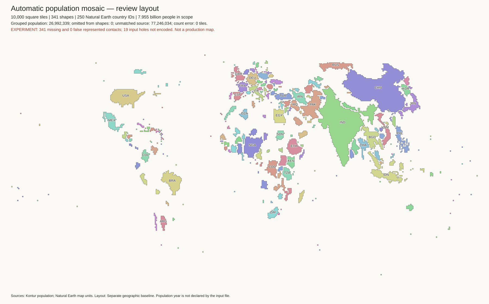
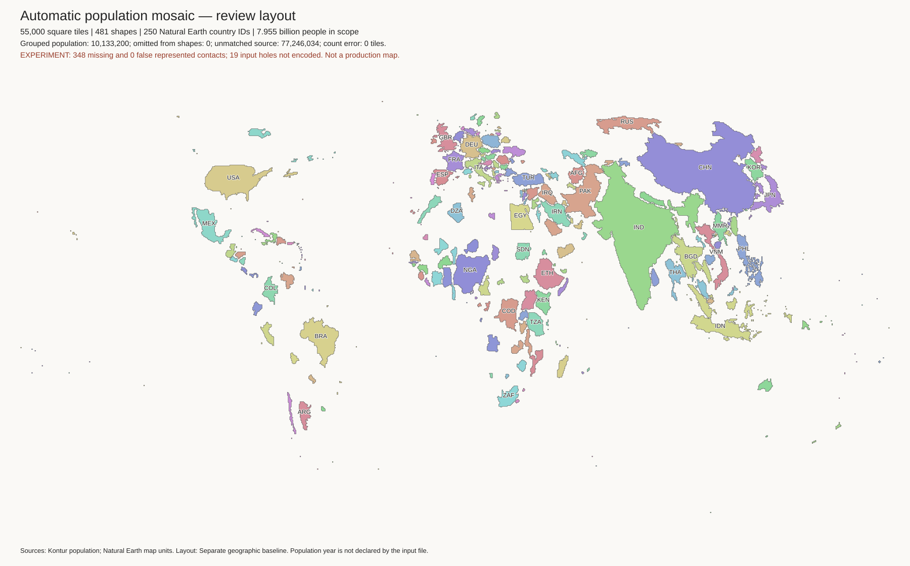
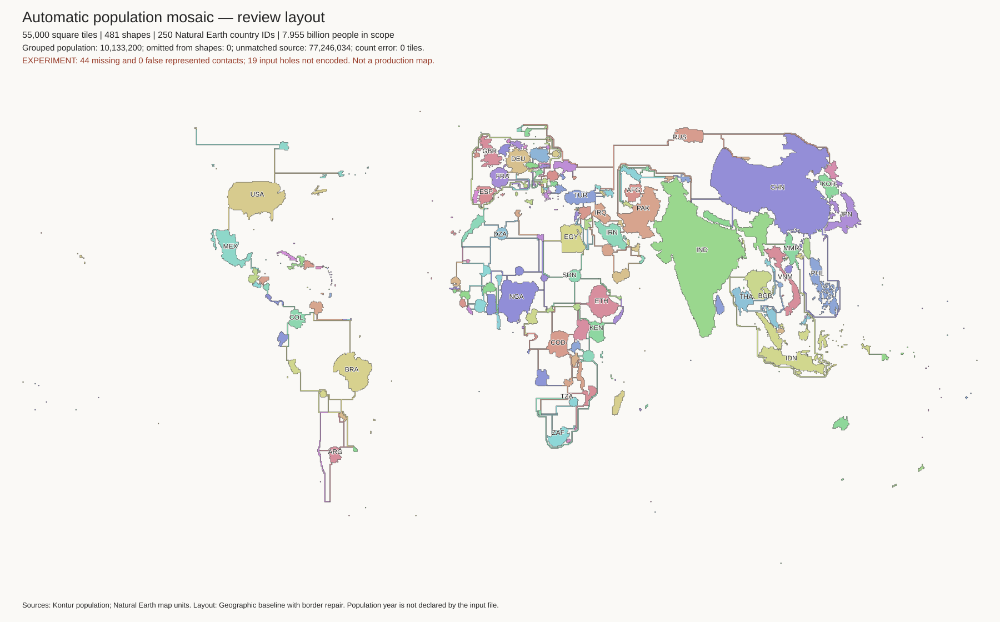
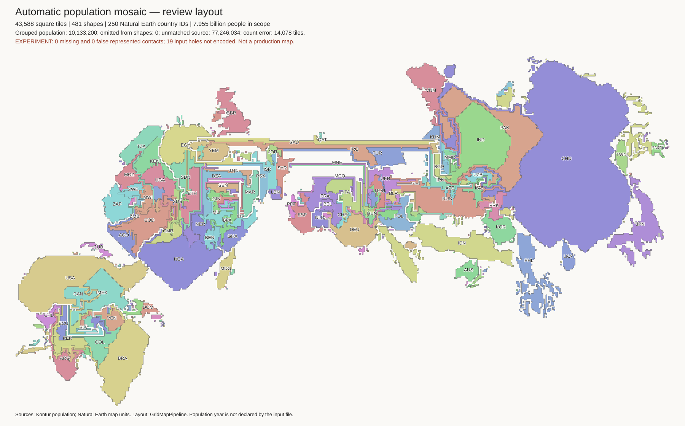

# Automatic world layouts: review gallery

**These are experiments, not production replacements.** Start with the three
geography-first images below. Then compare border repair and the topology-first
fit. Production targets and solver files are unchanged.

## Scope and common limits

All world images represent 7,954,677,990 matched people and 250 Natural Earth
entity IDs. Another 77,246,034 people in the source file are unmatched and
excluded. The source file does not declare a population year. See
[coverage diagnostics](results/world-coverage/summary.json).

The current inputs merge map-unit polygons that share a border within one
country. They do not merge disconnected islands or different countries.
This removes internal borders within Great Britain, Belgium, and other
countries. The [input checks](results/world-dissolved-input/contact-checks.json)
find no lost or added contacts after that union.

Components with no tile budget join a nearby represented component of the
same country. Their population remains in the country total, but their
individual island identity is lost in the target. This is different from the
geographic union above. Each populated entity receives at least one tile.
This can greatly exaggerate very small populations. Exact requested tile
counts are not exact population ratios. See each `country-counts.csv` file.

## Geography-first layouts

These layouts keep exact component tile counts, one side-connected part per
shape, and no four-neighbour holes. No cells overlap. They retain approximate
shape and position, but **remove every represented land border**. This fast
comparison method is not the published topology-preserving mosaic algorithm.

| Tiles | Separate shapes | People grouped into another component | Missing represented borders |
| ---: | ---: | ---: | ---: |
| 10,000 | 341 | 26,992,339 | 341 |
| 55,000 | 481 | 10,133,200 | 348 |
| 110,000 | 585 | 5,992,710 | 353 |

### 10,000 tiles

[Checks](results/world-10000-dissolved-geographic/metrics.json) ·
[Country area errors](results/world-10000-dissolved-geographic/country-counts.csv)

### 55,000 tiles

[Checks](results/world-55000-dissolved-geographic/metrics.json) ·
[Country area errors](results/world-55000-dissolved-geographic/country-counts.csv)

### 110,000 tiles

[Checks](results/world-110000-dissolved-geographic/metrics.json) ·
[Country area errors](results/world-110000-dissolved-geographic/country-counts.csv)

## Border repair: exact counts, incomplete borders

A greedy method extends a shape toward a required neighbour and removes the
same number of boundary cells. All three results retain exact counts,
connectivity, and the no-hole rule, with no false contacts. They restore many
borders but create long thin connectors. This is not an accepted visual result.

| Tiles | Retained borders | Missing borders | Country axis-order errors |
| ---: | ---: | ---: | ---: |
| 10,000 | 281 / 341 | 60 | 58 / 7,500 |
| 55,000 | 304 / 348 | 44 | 51 / 7,500 |
| 110,000 | 301 / 353 | 52 | 37 / 7,500 |

Other resolutions: [10,000](results/world-10000-dissolved-geographic-repair/review.png) ·
[110,000](results/world-110000-dissolved-geographic-repair/review.png).

## Topology-first fit: retained borders, wrong areas and positions

GridMapPipeline preserves the represented contacts in the completed fits below.
Independent checks find no false contacts, disconnected regions, or region holes.
However, the area and position errors are too large for a population map.

| Requested tiles | Actual tiles | Sum of absolute component count errors | Country axis-order errors |
| ---: | ---: | ---: | ---: |
| 10,000 | 9,895 | 1,931 | 811 / 7,500 |
| 55,000 | 43,588 | 14,078 | 2,270 / 7,500 |

[10,000-budget image](results/world-10000-dissolved-topology/review.png).
The small net count error in that run hides much larger local errors.
These bounded performance runs disable only per-move region assertions.
Their independent final checks do not approve their tile counts or geography.
The 110,000-budget fit and longer 10,000-budget tests are still in progress.

Original WKT outlines omit 19 holes. A successful contact check does not prove
correct enclave containment or full geographic topology. The exact-mode runs
on the earlier inputs failed an upstream count-improvement assertion; no result
from those failures is treated as complete.

## Islands and issue #17

The separate [Indonesia layout](results/indonesia-1894-automatic/review.png)
has 1,894 tiles in 51 groups. It keeps all 270,120,945 matched people in its
budgets, but groups 1,564,232 people from zero-budget components. Its small-island
positions still need work. Country-specific unmatched coverage is not assessed.

The native H3-8 grouped transport test now covers all 832,166 matched source
cells. Independent checks confirm their IDs, population, and group labels.
Cross-group transport is zero. The raw export retains 99.883% of population,
and its largest relative target error is 7.350%. See
[transport results](transport-results.md) for the capacity choice, sparse balance
experiment, flow tables, and limits. A good layout image alone does not prove
that population stays on its island.

## Decisions for review

1. Are gaps between countries acceptable? The geography-first layouts are the
   clearest current previews, but they remove land borders.
2. Does 110,000 tiles provide useful detail over 55,000 at the intended size?
3. Which small islands must have their own tile or inset instead of a group?
4. Can population per tile vary by group? Exact uniform country-wide capacity
   conflicts with the current integer budgets and zero cross-group movement.
5. What limits should apply to source retention, target error, and position?

Do not replace the OWID CSV yet. First settle these requirements, resolve
source coverage and year, and obtain a layout that passes the chosen checks.

## Evidence and reproduction

See [generator instructions](generator.md), [work log](work-log.md), and
[earlier map-unit trials](early-layouts.md). Saved result directories contain
PNGs, metrics, group tables, count errors, contact errors, and input hashes.
Large cell exports, SVG files, source membership, and downloaded tools remain
under ignored `output/auto-cartogram/` in the working environment.

The country order check uses the largest population-bearing shape of each
country with at least 10 million matched people. It excludes axis differences
below five degrees and longitude-seam pairs. The current geography-first
layouts have 48, 39, and 38 errors out of 7,500 comparisons. This is a diagnostic,
not a complete measure of geographic accuracy.
