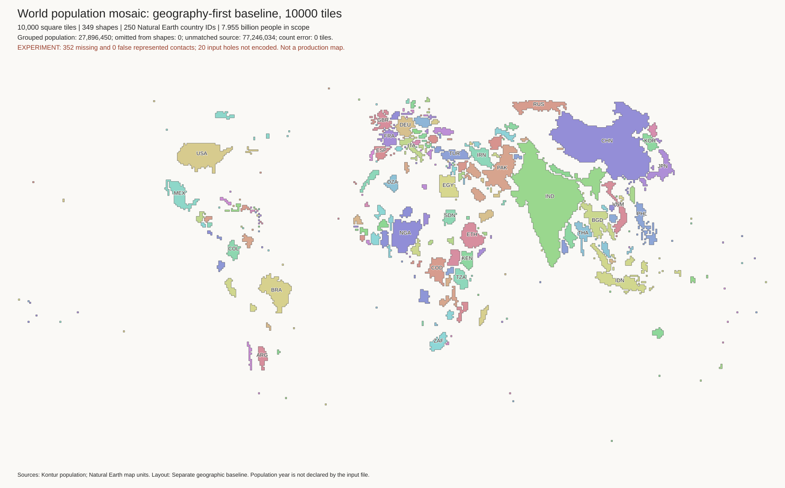
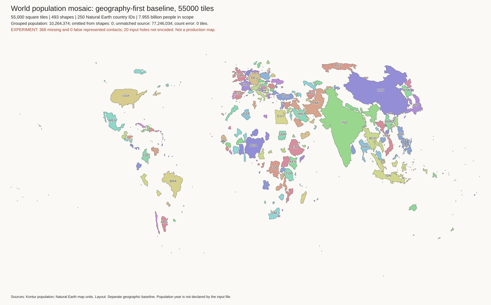
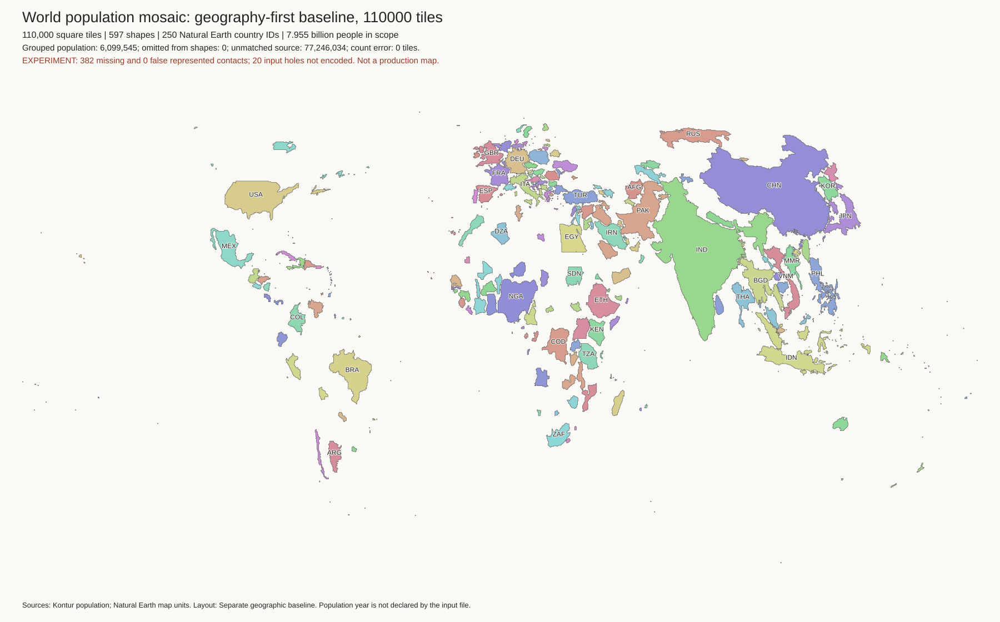
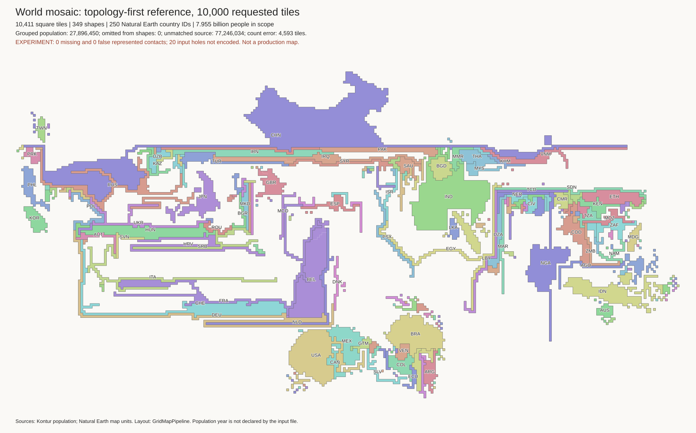
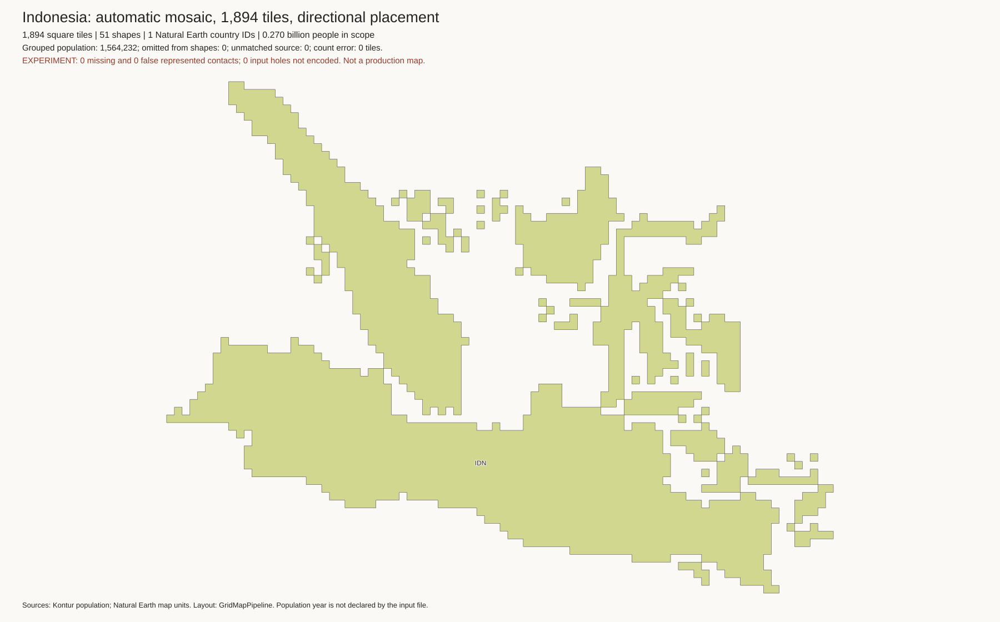

# Automatic layout review

These images are experiments. Do not replace the production map with them.
The source file has no declared population year.

## World: geography-first baseline

This method grows each represented polygon separately. It keeps its approximate
shape and uses its source position to place it. All shapes have exact requested
tile counts, one side-connected part, and no four-neighbour holes. No tiles
overlap. **All original land borders are missing.** This is a comparison method,
not the topology-preserving mosaic algorithm from the papers.

All three layouts contain 7,954,677,990 matched people and 250 Natural Earth
entity IDs. Another 77,246,034 source people are unmatched and excluded. The
caption reports this exclusion. See [coverage diagnostics](results/world-coverage/summary.json).

| Tiles | Separate shapes | People grouped into another component | Missing represented borders |
| ---: | ---: | ---: | ---: |
| 10,000 | 349 | 27,896,450 | 352 |
| 55,000 | 493 | 10,264,374 | 368 |
| 110,000 | 597 | 6,099,545 | 382 |

The number of missing borders increases because more components are represented.
Grouped people remain in their country total. Grouping does not preserve their
individual island identity in the target. Each populated source entity gets at
least one tile. This gives very small populations too much area, particularly
at 10,000 tiles. Inspect `country-counts.csv`; exact requested counts are not
exact population ratios.

### 10,000 tiles

[Counts and checks](results/world-10000-geographic/metrics.json) ·
[Country area errors](results/world-10000-geographic/country-counts.csv)

### 55,000 tiles

[Counts and checks](results/world-55000-geographic/metrics.json) ·
[Country area errors](results/world-55000-geographic/country-counts.csv)

### 110,000 tiles

[Counts and checks](results/world-110000-geographic/metrics.json) ·
[Country area errors](results/world-110000-geographic/country-counts.csv)

### What to inspect

- Can you identify regions without the labels?
- Are islands on the correct side of the mainland?
- Is the extra detail at 110,000 tiles useful at the normal display size?
- Are gaps acceptable, or must countries share borders?
- Which small islands need their own tile, inset, or separate display layer?

The order check compares east/west and north/south signs for represented pairs
within one country. It excludes source differences below one degree and
longitude-seam pairs. It finds 42 errors in 719 comparisons at 10,000 tiles,
135 in 3,727 at 55,000, and 218 in 7,129 at 110,000. These are diagnostics,
not a full geographic accuracy score.

A second check compares the largest population-bearing shape of each country
with at least 10 million matched people. It excludes axis differences below
five degrees. The baseline has 48, 41, and 39 reversed comparisons out of 7,500
at the three resolutions. This simple check does not assess shape or distance.

## World: exact counts with border repair

A separate greedy method extends a shape toward a required neighbour, then
removes the same number of boundary cells. It preserves exact component counts,
connectivity, and the no-hole rule. It creates no false contacts. It cannot
restore all borders, and the long thin connectors are poor geographic shapes.
This is not the published mosaic algorithm.

| Tiles | Retained represented borders | Missing borders | Country axis-order errors |
| ---: | ---: | ---: | ---: |
| 10,000 | 270 / 352 | 82 | 61 / 7,500 |
| 55,000 | 312 / 368 | 56 | 47 / 7,500 |
| 110,000 | 311 / 382 | 71 | 36 / 7,500 |

Other resolutions: [10,000 tiles](results/world-10000-border-repair/review.png) ·
[110,000 tiles](results/world-110000-border-repair/review.png).
Each directory contains the independent checks and attempted repairs.
The coverage and grouping limits are the same as the geography-first baseline.

## World: topology-first reference

The Java fit below keeps all 352 represented borders with no false contacts,
disconnected regions, or region holes. **It is not a valid population map.**
It has 10,411 tiles against a 10,000-tile budget. The sum of absolute component
count errors is 4,593 tiles; the small net difference hides large local errors.
The country axis-order check finds 3,217 errors in 7,500 comparisons.

This reference used all Java assertions. An optional initial rotation/reflection
improves global order but does not solve the problem: the
[oriented fit](results/world-10000-topology-oriented/review.png) has 4,640 tiles
of absolute count error and 1,098 country axis-order errors. That performance
run disabled only per-move region assertions; independent final checks passed
for connectivity, holes, and represented borders, not for tile counts.

The results show why a contact check alone is not an acceptance test. We need
area, shape, position, island, and containment checks together.

## Indonesia: GridMapPipeline with directional placement

[Counts and checks](results/indonesia-1894-automatic/metrics.json) ·
[Component groups](results/indonesia-1894-automatic/input-groups.csv)

This checked run has 51 separate shapes and 1,894 tiles. It represents all
270,120,945 people in the matched Indonesia input. It groups 1,564,232 people
from zero-budget components into nearby represented components in Indonesia.
Country-specific unmatched coverage is not assessed. The global nearest-polygon
diagnostic finds 7,369,170 unmatched people nearest Indonesian polygons, but
proximity is not proof of ownership. Do not read the matched total as a census.
Counts, unique ownership, side connectivity, and no-hole checks pass. There are
no required contacts among these Indonesia-only components, so the contact
check does not test the difficult global land graph.

The largest islands are recognizable, but small-island placement still needs
work. The order diagnostic finds 426 errors in 2,323 comparisons. Do not treat
the directional rule as a complete solution to issue #17.

## Issue #17: what this changes

The pipeline now has explicit source component IDs, target component IDs,
component tile budgets, and a recorded grouping table. This is the information
needed to prevent unrecorded cross-island transport. An optional experimental
wrapper now solves each declared group separately. The production solver path
is unchanged. See [transport results](transport-results.md) for measured flows,
retained mass, target errors, and the capacity trade-off. Layout images alone
cannot show that source population stays on its own island.

Before production use:

1. Review grouping rules for islands with less than one tile of population.
2. Choose group capacity rules before integrating eligibility into production.
3. Test native-cell retention and target balance, not only cross-group mass.
4. Resolve unmatched coastal cells and input-year provenance.
5. Test a valid world layout that retains required land borders and containment.

## Reproduce and inspect evidence

See [generator instructions](generator.md) and [work log](work-log.md). Each
result directory has a PNG, checks, country counts, component groups, and file
hashes. Large tile exports, SVG files, source membership, and downloaded tools
remain under ignored `output/auto-cartogram/` in the working environment.
