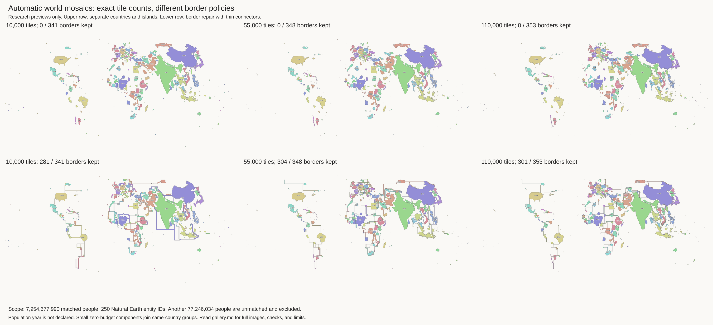
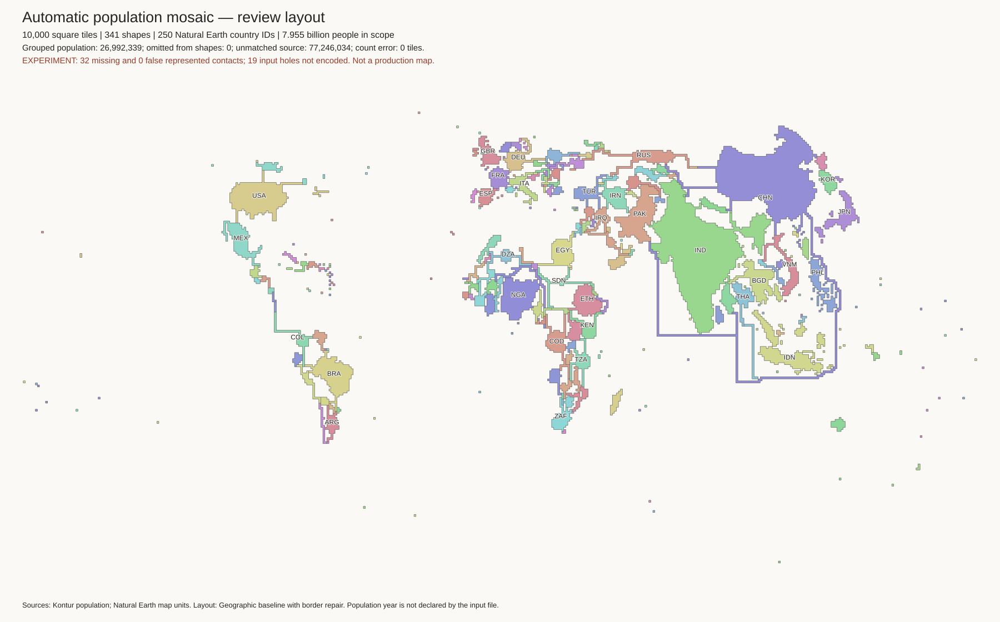
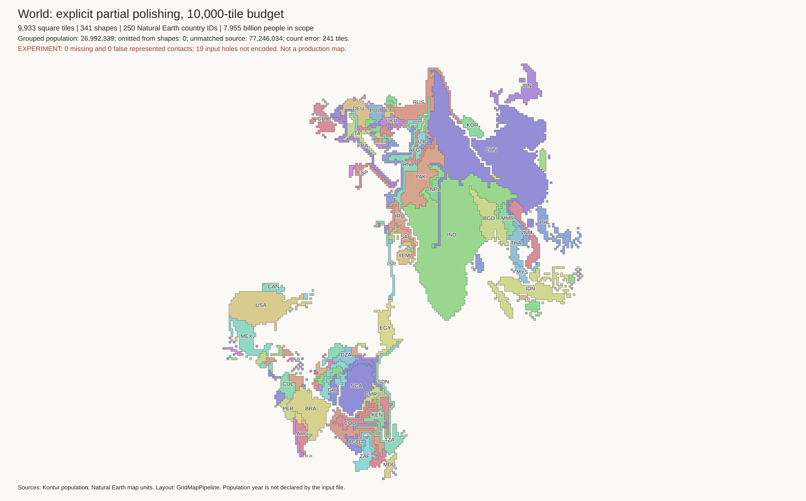
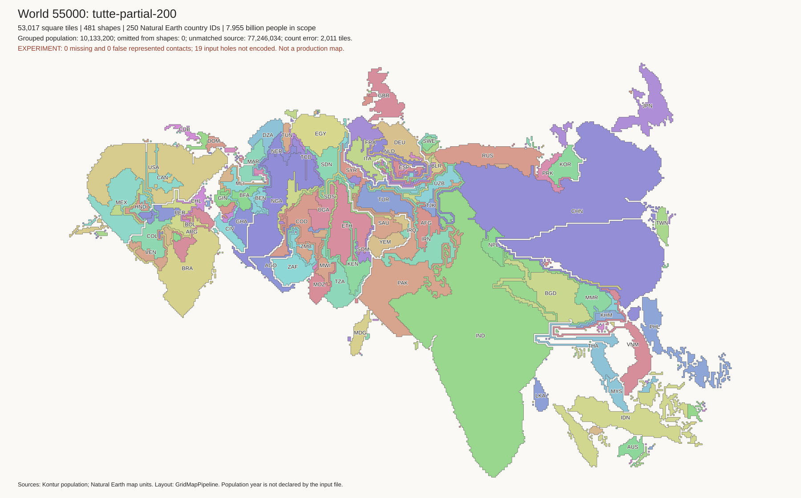
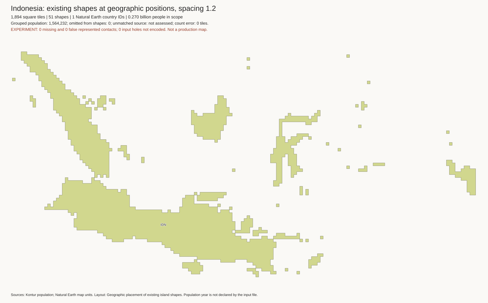

# Automatic world layouts: review gallery

**These are experiments, not production replacements.** Start with the three
geography-first images below. Then compare border repair and the topology-first
fit. Production targets and solver files are unchanged.

The overview combines six published images. Open the full images below to
inspect small islands and country labels.

## Scope and common limits

All world images represent 7,954,677,990 matched people and 250 Natural Earth
entity IDs. Another 77,246,034 people in the source file are unmatched and
excluded. The source file does not declare a population year. See
[coverage diagnostics](results/world-coverage/summary.json).

The current inputs merge map-unit polygons that share a border within one
country. They do not merge disconnected islands or different countries.
This removes internal borders within Great Britain, Belgium, and other
countries. The [input checks](results/world-dissolved-input/contact-checks.json)
find no lost or added contacts after that union.

Components with no tile budget join a nearby represented component of the
same country. Their population remains in the country total, but their
individual island identity is lost in the target. This is different from the
geographic union above. Each populated entity receives at least one tile.
This can greatly exaggerate very small populations. Exact requested tile
counts are not exact population ratios. See each `country-counts.csv` file.

## Geography-first layouts

These layouts keep exact component tile counts, one side-connected part per
shape, and no four-neighbour holes. No cells overlap. They retain approximate
shape and position, but **remove every represented land border**. This fast
comparison method is not the published topology-preserving mosaic algorithm.

| Tiles | Separate shapes | People grouped into another component | Missing represented borders |
| ---: | ---: | ---: | ---: |
| 10,000 | 341 | 26,992,339 | 341 |
| 55,000 | 481 | 10,133,200 | 348 |
| 110,000 | 585 | 5,992,710 | 353 |

### 10,000 tiles

[Checks](results/world-10000-dissolved-geographic/metrics.json) ·
[Country area errors](results/world-10000-dissolved-geographic/country-counts.csv)

### 55,000 tiles

[Checks](results/world-55000-dissolved-geographic/metrics.json) ·
[Country area errors](results/world-55000-dissolved-geographic/country-counts.csv)

### 110,000 tiles

[Checks](results/world-110000-dissolved-geographic/metrics.json) ·
[Country area errors](results/world-110000-dissolved-geographic/country-counts.csv)

## Border repair: exact counts, incomplete borders

A greedy method extends a shape toward a required neighbour and removes the
same number of boundary cells. All three results retain exact counts,
connectivity, and the no-hole rule, with no false contacts. They restore many
borders but create long thin connectors. This is not an accepted visual result.

| Tiles | Retained borders | Missing borders | Country axis-order errors |
| ---: | ---: | ---: | ---: |
| 10,000 | 281 / 341 | 60 | 58 / 7,500 |
| 55,000 | 304 / 348 | 44 | 51 / 7,500 |
| 110,000 | 301 / 353 | 52 | 37 / 7,500 |

Other resolutions: [10,000](results/world-10000-dissolved-geographic-repair/review.png) ·
[110,000](results/world-110000-dissolved-geographic-repair/review.png).

### Translation before repair

Moving whole shapes toward required neighbours can reduce later connector
lengths. It also changes geographic order. At 10,000 tiles, stiffness 0.05
reduces missing borders from 60 to 32 and raises weighted compactness from
0.175 to 0.193. Country axis-order errors rise from 58 to 105. At the larger
resolutions, the tested settings do not improve the number of retained borders.
See the [nine-run comparison](results/relaxation-comparison.csv).

This keeps exact counts and has no false contacts, disconnected regions, or
region holes. It still has thin connectors and is not a production layout.

## Topology-first fit: retained borders, wrong areas and positions

GridMapPipeline preserves the represented contacts in the completed fits below.
Independent checks find no false contacts, disconnected regions, or region holes.
However, the area and position errors are too large for a population map.

| Requested tiles | Actual tiles | Sum of absolute component count errors | Country axis-order errors |
| ---: | ---: | ---: | ---: |
| 10,000 | 9,895 | 1,931 | 811 / 7,500 |
| 55,000 | 43,588 | 14,078 | 2,270 / 7,500 |
| 110,000 | 71,350 | 39,310 | 1,038 / 7,500 |

[10,000-budget image](results/world-10000-dissolved-topology/review.png).
The small net count error in that run hides much larger local errors.
These bounded runs kept model and region assertions enabled. An early status
field reported the wrong nested-class setting; each affected result has an
`assertion-status-correction.json` record. Their independent final checks do
not approve their tile counts or geography.
[110,000-budget image](results/world-110000-dissolved-topology/review.png).
A full-default run on the earlier map-unit input reduces the 10,000-budget
absolute count error to 1,013, but still fails the area requirement. Longer
fits on the dissolved inputs are reported below.

### Longer fits and corrected flow

The [comparison table](results/topology-comparison.csv) records completed
full-default fits, fixed drawing transforms, a convex-boundary initializer,
and corrected partial polishing. It includes input, build, and cell hashes.
All listed fits retain represented contacts, but none has exact tile budgets.

At 10,000 tiles, corrected partial polishing reduces absolute count error to
241, with 500 country order errors. Extending its limit from 40 to 200 passes
produces byte-identical cells. The largest connected part stops after 29 passes.
Ethiopia still receives only 43 of its requested 158 tiles. A small global
error can hide a large error for one country.

Earlier rows in the table predate the flow-feasibility correction. Their final
geometric checks remain valid, but their internal flow results are not a proof
of feasible population allocation. Read the [work log](work-log.md) for the
failed and stopped trials. A [failure table](results/generator-failures.csv)
records 14 selected failures, stops, and timeouts with log hashes. Those trials
used different inputs and builds; they are not completed layouts.

The corrected 55,000-tile fit with a convex-boundary initializer and 200
polishing passes has 53,017 tiles and 2,011 tiles of absolute component error.
Its 40-pass version has 2,317 tiles of error. At 110,000 tiles, increasing the
integer-initialized fit from 40 to 200 passes reduces absolute error from 9,069
to 6,140 tiles. It finishes with 103,884 tiles. All represented contacts remain,
but neither layout has acceptable area or geographic accuracy. Europe has many
narrow strips in the 55,000-tile image.

| Budget | Selected corrected fit | Actual tiles | Absolute component error | Country order errors |
| ---: | --- | ---: | ---: | ---: |
| 10,000 | Integer initialization, 40 passes | 9,933 | 241 | 500 |
| 55,000 | Convex-boundary initialization, 200 passes | 53,017 | 2,011 | 1,368 |
| 110,000 | Integer initialization, 200 passes | 103,884 | 6,140 | 670 |

[Corrected 200-pass fit at 110,000 tiles](results/world-110000-partial-200/review.png) ·
[Earlier 40-pass fit](results/world-110000-partial-polish/review.png).

Original WKT outlines omit 19 holes. A successful contact check does not prove
correct enclave containment or full geographic topology. The exact-mode runs
on the earlier inputs failed an upstream count-improvement assertion; no result
from those failures is treated as complete.

## Islands and issue #17

The separate [Indonesia layout](results/indonesia-1894-automatic/review.png)
has 1,894 tiles in 51 groups. It keeps all 270,120,945 matched people in its
budgets, but groups 1,564,232 people from zero-budget components. Its small-island
positions still need work. Country-specific unmatched coverage is not assessed.

A new placement test keeps those exact island shapes and counts, but places
them near projected source centroids. It requires no land contacts, so it is
not a method for moving adjacent countries independently. Island axis-order
errors fall from 426 to 18, 5, and 3 out of 2,323 comparisons at spacing settings
1.0, 1.2, and 1.6. All three have exact counts, no overlaps, no false contacts,
and no disconnected shapes or region holes. Larger spacing leaves more gaps.

Other spacing settings: [1.0](results/indonesia-reposition-1.0/review.png) ·
[1.6](results/indonesia-reposition-1.6/review.png).
These are placement checks. The balanced native mapping has also been moved
to the spacing-1.2 layout through checked integer translations, without changing
weights or solving again. Its independent flow and native-source checks pass:
[improved-position transport image](results/indonesia-native-repositioned/review.png).

The native H3-8 grouped transport test now covers all 832,166 matched source
cells. Independent checks confirm their IDs, population, and group labels.
Cross-group transport is zero. The raw export retains 99.883% of population,
and its largest relative target error is 7.350%. A separate sparse correction
restores all source mass to floating-point precision, keeps cross-group mass
at zero, and reduces maximum relative target error below 0.01%. It does not
add source-target pairs. See [transport results](transport-results.md) for the
capacity choice, flow tables, and limits. A good layout image alone does not prove
that population stays on its island.

## Decisions for review

1. Are gaps between countries acceptable? The geography-first layouts are the
   clearest current previews, but they remove land borders.
2. Does 110,000 tiles provide useful detail over 55,000 at the intended size?
3. Which small islands must have their own tile or inset instead of a group?
4. Can population per tile vary by group? Exact uniform country-wide capacity
   conflicts with the current integer budgets and zero cross-group movement.
5. What limits should apply to source retention, target error, and position?

Do not replace the OWID CSV yet. First settle these requirements, resolve
source coverage and year, and obtain a layout that passes the chosen checks.

## Evidence and reproduction

See [generator instructions](generator.md), [work log](work-log.md), and
[earlier map-unit trials](early-layouts.md). Saved result directories contain
PNGs, metrics, group tables, count errors, contact errors, and input hashes.
Large cell exports, SVG files, source membership, and downloaded tools remain
under ignored `output/auto-cartogram/` in the working environment.

The country order check uses the largest population-bearing shape of each
country with at least 10 million matched people. It excludes axis differences
below five degrees and longitude-seam pairs. The current geography-first
layouts have 48, 39, and 38 errors out of 7,500 comparisons. This is a diagnostic,
not a complete measure of geographic accuracy.
