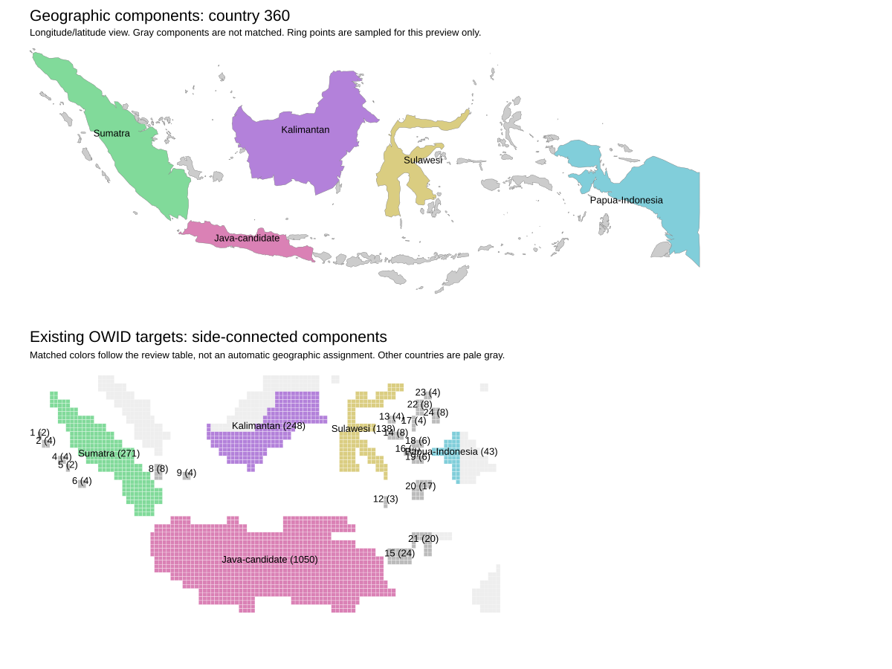

# Indonesia island audit: first results

## Finding

**The current layout has a large island-capacity mismatch.** With the four
reviewed major-island matches below, at least **19.98 million people (7.40%)**
must cross those component labels in a balanced country-wide solve.

This is a conditional capacity lower bound, not a measured transport result.
It assumes that the reviewed artwork components represent the corresponding
geographic polygons. Smaller unresolved islands are pooled on both sides.
Java is not included as a separate matched group because its artwork may also
contain Madura or other islands.

The main excess is in **Kalimantan**, the Indonesian mainland portion of Borneo.
Its 248 tiles have capacity for 35.37 million people under the country's equal
per-tile mass. The selected geographic population is only 16.49 million.
No choice of eta can remove that excess capacity from a fixed target layout.

## Inputs and checks

This run used the audit implementation in commit `92406fa` and the checked-in
[indonesia-matches.csv](indonesia-matches.csv). Full input, code, match, and
environment hashes are in the [run manifest](results/indonesia/manifest.json).

| Quantity | Result |
| --- | ---: |
| Selected source population | 270,120,945 |
| Selected native H3-8 source cells | 832,166 |
| H3-8 cell centres inside the boundary polygons | 2,411,250 |
| Geographic polygon components | 264 |
| Components with positive source population | 252 |
| Existing OWID target tiles | 1,894 |
| Side-connected target components | 25 |
| Reviewed one-to-one matches | 4 |
| Provisional matches | 1 |

The population Arrow file has no declared year. These are its raw sums, not
OWID 2026 population estimates. The Natural Earth snapshot also has no version
record in its local readme. Hashes identify the exact inputs; their release
years remain unresolved.

A separate run of the existing `scripts/extract_kontur_country.jl` produced the
same 832,166 source IDs and the same population for **every ID**. Thus component
assignment preserves the current country extractor's selection. This check does
not establish that the boundary dataset includes every Indonesian island.

All 215 checks passed: 204 synthetic checks and 11 saved-result checks.
They cover holes, component identity under polygon reordering, duplicate and
overlapping ownership, invalid inputs, side adjacency, budget rounding, partial
matches, a complete file-based run, and consistency of the saved Indonesia tables.
The audit ran headlessly. One reviewed run took 58.0 seconds of wall time,
including Julia startup; the manifest records 40.2 seconds inside `run`.
Peak memory was not measured. These are single-run timings, not a benchmark.

## Major-island comparison

Positive excess means the artwork must receive population from outside the
matched geographic component. Negative excess means it must send population
elsewhere. Capacities use `270,120,945 / 1,894` people per tile.

| Component | Source population | Population share | Existing tiles | Tile share | Excess capacity, people |
| --- | ---: | ---: | ---: | ---: | ---: |
| Sumatra | 53,346,054 | 19.75% | 271 | 14.31% | −14,696,225 |
| Kalimantan | 16,494,686 | 6.11% | 248 | 13.09% | +18,874,899 |
| Sulawesi | 18,575,299 | 6.88% | 138 | 7.29% | +1,106,164 |
| Indonesian New Guinea | 7,138,335 | 2.64% | 43 | 2.27% | −1,005,705 |
| Unmatched remainder, including Java | 174,566,571 | 64.63% | 1,194 | 63.04% | −4,279,133 |

The absolute excesses sum to twice the lower bound. The remainder is not a
single geographic component and must not become a default transport group.
Its internal mismatches are not measured here.

The coding agent reviewed matches by shape, relative position, and border
context. Kalimantan's artwork touches Malaysian cells, and Indonesian New
Guinea touches Papua New Guinea cells. The match table records geographic and
target seeds so the associations can be checked and changed. They are not
source metadata recovered from the original artwork.

Even if Sulawesi's small excess is excluded, the Kalimantan match alone implies
at least 18.87 million people of cross-label movement. Confirm its island
membership before treating that number as a production acceptance threshold.



Gray geographic components have no reviewed or provisional match. The Java
candidate is colored for inspection only; it does not enter the bound as its
own group. The smaller target numbers refer to row order in `targets.csv`.
Hover labels are available in the generated SVG. Its ring geometry is sampled
for the preview, as described in the readme.

## Budgets for a generated layout

Largest-remainder allocation over all 264 geographic components gives these
counts at the existing 1,894-tile country budget:

| Geographic component | Calculated tiles | Existing matched artwork tiles |
| --- | ---: | ---: |
| Main Java polygon | 1,042 | 1,050, provisional correspondence |
| Sumatra | 374 | 271 |
| Kalimantan | 116 | 248 |
| Sulawesi | 130 | 138 |
| Indonesian New Guinea | 50 | 43 |
| Madura | 25 | Unresolved |

These are component budgets, not a new layout. The Java and Madura counts show
why a connected artwork shape must not automatically be equated with one island.
No claim is made that they are both represented by the existing 1,050-cell shape.

There is a second problem: **201 inhabited components receive zero tiles**.
Their combined population is **1,564,232 (0.58%)**. The largest omitted component
has 49,455 people. All these sources remain in `source-components.arrow`.
They must not be dropped when the generator is added.

Only 51 geographic components receive positive integer budgets. Twelve more
components have no selected population rows. Every polygon contains at least
one H3-8 centre, so none is lost solely because polygon filling returned no cells.
Zero selected population can still reflect data or coastline problems.

Before generation, choose a policy for small islands. Compare explicit nearby
island groups, population-bearing insets, and a larger tile budget. A minimum
of one tile per inhabited polygon would inflate many island areas. Simply
subdividing the current artwork would preserve its wrong island shares.

## Boundary and matching uncertainty

About **7.71 million people (2.86%)** occupy source cells with an H3 neighbour
outside their component. This includes coasts and international land borders.
It is not a count of incorrectly assigned people or a confidence interval.
Review these cells before interpreting small differences as layout defects.

The [readme](readme.md#method-and-limits) lists geometry and membership limits.
In particular, these are polygon components, not repaired physical landmasses.

The four reviewed matches still need independent review. In particular, the
artwork can join small offshore islands to a large island. The current matching
format supports only one geographic polygon per target component. Java remains
provisional for that reason. More matches are not useful unless their membership
is sufficiently clear.

## Reproduce

Follow the environment setup in the [readme](readme.md). Then run:

```sh
julia --project=examples/auto-cartogram examples/auto-cartogram/audit.jl \
  ~/projects/gtfs_ffs/data/kontur_h3.arrow \
  make-lookup-table/population-data/country-boundaries/ne_10m_admin_0_map_units.geojson \
  data/cartogram.csv output/auto-cartogram/indonesia-reviewed \
  360 examples/auto-cartogram/indonesia-matches.csv
```

Use another output path if that directory exists. To repeat the comparison
with the current extractor:

```sh
julia --project=examples/auto-cartogram scripts/extract_kontur_country.jl \
  ~/projects/gtfs_ffs/data/kontur_h3.arrow 360 \
  output/auto-cartogram/country-360-baseline.arrow 8
julia --project=examples/auto-cartogram -e '
  using Arrow, DataFrames
  a = DataFrame(Arrow.Table(ARGS[1]))
  b = DataFrame(Arrow.Table(ARGS[2]))
  sort!(a, :id); sort!(b, :id)
  @assert a.id == b.id
  @assert a.population == b.value
  @assert a.country_code == b.country_code
' output/auto-cartogram/country-360-baseline.arrow \
  output/auto-cartogram/indonesia-reviewed/source-components.arrow
```

The checked-in [result tables](results/indonesia/) are copies of that run.
The 41 MiB source-membership Arrow file and the SVG stay under ignored `output/`.
The preview PNG was made headlessly with:

```sh
rsvg-convert output/auto-cartogram/indonesia-reviewed/overview.svg \
  -o output/auto-cartogram/indonesia-reviewed/overview.png
```

Credit Kontur for population data, Natural Earth for boundaries, and Our World
in Data for the existing artwork. Source links are in the [readme](readme.md).

## Next step

Build a headless GridMapPipeline adapter for the five major components and
their calculated budgets. Label this as a partial trial, and report the excluded
small-island population. Do not publish it as all of Indonesia.

Then define the small-island policy, generate the complete country, and run
transport per component or declared group. Keep OWID as the baseline until
population accounting, island placement, and readability checks pass.
