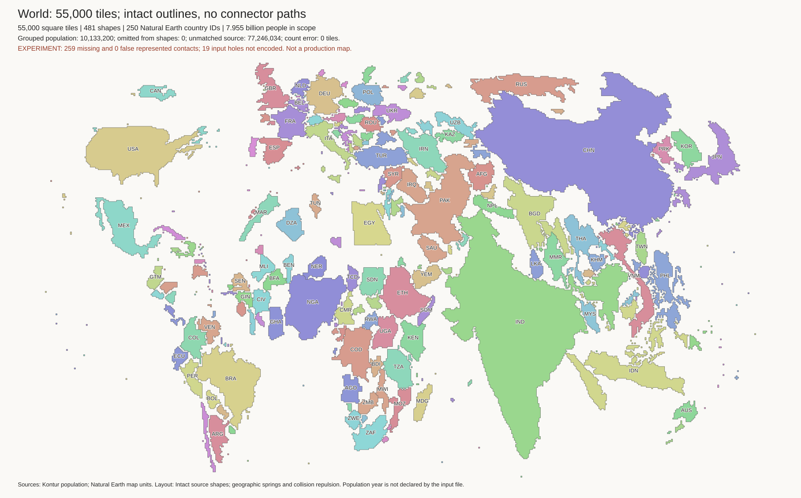
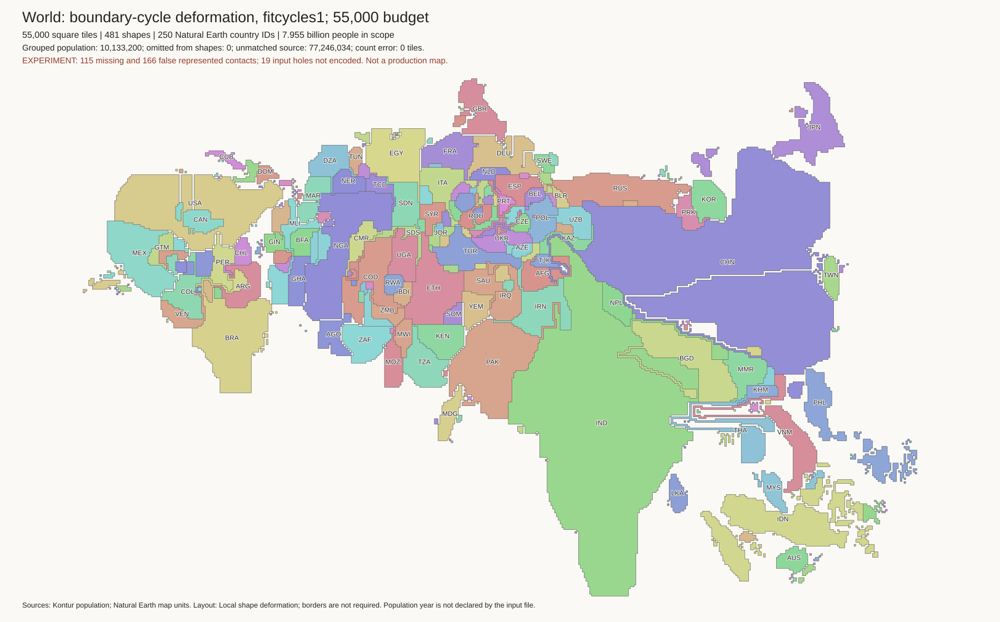
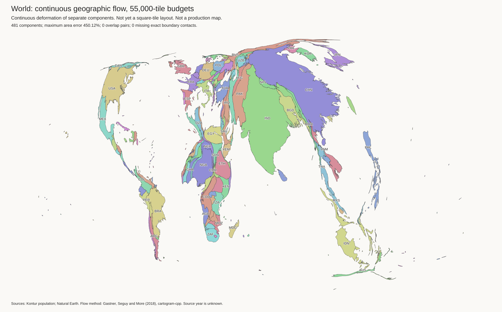

# Shape-first cartogram trials

This is an active experiment. The work window ends at 19:50 UTC on
2026-10-14. These are intermediate results, not an approved replacement.
Production code and `data/cartogram.csv` have not changed.

Open the [image gallery](results/shape-first/index.html) for the current review
candidate. It is a static HTML page. A plain file server can display it.
See the [work log](shape_work_log.md) for times and failures.

## What causes the thin strips?

The 55,000-tile contact audit found 348 real shared source borders. It found
no contact that joins components only because they have the same country ID.
France and French Guiana are separate components. They do not have an
artificial connecting edge.

Only 26 contacts involve a component other than its country's largest
population group. Some are land borders on shared islands. These contacts
must not all be classified as overseas errors.

The worst thin regions also include mainland countries. Hard border
constraints and the initial layout cause problems that island grouping cannot
solve. Removing a required border must not remove the component's population.

## Current direction: move intact component shapes



Each component gets a connected tile template from its source outline and
population budget. The solver moves these templates. It does not add cells to
reach a border. Separate islands remain separate components when they have a
tile budget. Shared country membership does not require a connection.

The position solver uses soft preferences for real borders, nearby source
components, and geographic direction. A collision cost discourages overlap.
Final integer placement prevents overlap and false borders. An independent
check compares every output shape with its template. Each must be an exact
integer translation.

The current 55,000-tile candidate has:

- Exact component tile budgets, with 481 represented components.
- No false borders, disconnected components, or tile holes.
- 89 retained source borders out of 348. Missing borders are permitted.
- No added connector paths. Natural narrow coast features remain.

Visual review finds substantial position errors. Singapore is north of
peninsular Malaysia. Sri Lanka is too far north. North America has large gaps.
The direction cost does not prove correct geographic positions. Further trials
will use nearest source coast points to position separated components, rather
than only their centres. These position preferences do not create border paths.

The gallery now includes 10,000, 55,000, 110,000, and 500,000 tiles. These are
separate trials, not a controlled resolution test with identical settings.
The 500,000-tile trial uses no geographic-order cost. Further trials continue.

| Tiles | Represented components | Grouped island population | Retained source borders |
| ---: | ---: | ---: | ---: |
| 10,000 | 341 | 26,992,339 | 70 / 341 |
| 55,000 | 481 | 10,133,200 | 89 / 348 |
| 110,000 | 585 | 5,992,710 | 95 / 353 |
| 500,000 | 888 | 1,865,414 | 101 / 359 |

All four have exact requested tile budgets and no false contacts. The largest
layout has more coast detail, but it still puts Sri Lanka near Malaysia. Its
Indonesia detail shows that small shape errors and correct counts do not prove
correct island positions. It also does not represent every island.

Local distortion remains an option, not the default. The bounded trials removed
coast detail without a sufficient improvement in border retention. The current
comparison therefore keeps the templates intact. It is not a production map.

## First comparison: release the border constraints

[View the original Tutte fit](results/world-55000-tutte-partial-200/review.png).



This trial uses local cell transfers. It does not draw paths to restore
borders. The transfer graph records exchanges of cell ownership. It is not a
set of lines to draw on the map.

| Check | Original Tutte fit | Boundary-cycle trial |
| --- | ---: | ---: |
| Requested tiles | 55,000 | 55,000 |
| Actual tiles | 53,017 | 55,000 |
| Sum of absolute component count errors | 2,011 | 0 |
| Missing required contacts | 0 | 115 |
| False contacts | 0 | 166 |
| Disconnected tile regions | 0 | 0 |
| Tile regions with holes | 0 | 0 |
| Thin-detail share, 3-by-3 opening test | 11.98% | 3.73% |

The thin-detail test includes only regions with at least 25 tiles. It also
counts natural coast detail. It is a diagnostic, not a quality score.

Visual review: Europe has fewer thin strips. However, the Americas have poor
country order. Long detours remain near Vietnam and Nepal. The false contacts
are not acceptable as an unmarked replacement map. This is a useful test of
count correction, not the final layout.

A second test checks topology after a complete exchange. The first test checks
each temporary state and can prevent a useful shortcut. For example, a valid
exchange can temporarily close a loop before it removes the old detour. The
second test accepts the exchange only if the final regions are connected and
have no holes. Tests cover this case and rollback after a failed exchange.

## Rejected continuous-flow trial



The flow method preserves all 348 contacts and all 19 source holes in this
run. It has no measured overlap. But Canada, Russia, Australia, and much of
the Americas become very thin. Visual review rejects this result.

The implementation also raises some small target areas. Its convergence check
therefore differs from our check against the original tile budgets. One
component has a 450% area error against its original target. Do not use the
upstream convergence message as proof that our budgets are correct.

A separate world-mode run failed during line densification. A run without
simplification finished, but our geometry check rejected an invalid Canadian
component. Neither result is an accepted layout.

## Scope and limits

- The world source contains 7,954,677,990 matched people. Another 77,246,034
  people are unmatched. The source year is unknown.
- At 55,000 tiles, zero-budget islands contribute 10,133,200 people to larger
  groups of the same country. This preserves their population, not their
  individual island shapes.
- The tile experiments omit 19 source holes through 110,000 tiles and 20 at
  500,000 tiles. A tile region with no holes is not proof that the original
  geographic topology is preserved.
- Moving intact country shapes removes artificial strips, but greedy placement
  can change country order. Those trials need further position checks.
- No new native-resolution population transport has been approved for these
  layouts. The earlier transport results do not certify new cell positions.

## Tools

Use the experimental Python environment from [the generator guide](generator.md).
Its requirements now include SciPy 1.17.1.

```sh
python test/auto_shapes.py
python examples/auto-cartogram/compact_regions.py INPUT INITIAL OUTPUT \
  --fit-rounds 3000 --rounds 1000 --cycles
python examples/auto-cartogram/compact_regions.py INPUT OUTPUT NEXT \
  --rounds 2000 --atomic
python examples/auto-cartogram/review_layout.py INPUT NEXT
rsvg-convert NEXT/review.svg -o NEXT/review.png
```

`INPUT` contains the prepared group table and validated outlines. `INITIAL`
contains a complete tile layout. Use a new path for each output directory.
The count fit can stop before it reaches the requested counts. Check
`absolute_tile_error` in `compact.json` and the independent `metrics.json`.

For intact-shape placement and the checked image gallery:

```sh
python examples/auto-cartogram/shape_stress.py INPUT TEMPLATES PLACED \
  --iterations 10000 --collision 100 --gap .1 --anchor .001 \
  --ocean-scale .1 --order-weight 5 --source-polygons POLYGONS \
  --smooth-collision --no-false-contacts
python examples/auto-cartogram/publish_shape_review.py \
  INPUT TEMPLATES PLACED BUNDLE
python examples/auto-cartogram/build_shape_gallery.py INDEX.html BUNDLE
```

`TEMPLATES` is the geographic baseline layout. `POLYGONS` is the dissolved
source component GeoJSON. The publisher checks counts, connectivity, holes,
false borders, and unchanged template shapes before it saves a bundle.
It uses `rsvg-convert` to render images without a display. The bundle includes
compressed output cells and templates. It does not include the full source
population data needed to generate new budgets.

The optional continuous-flow build is separate:

```sh
examples/auto-cartogram/bootstrap_flow.sh
```

It pins [cartogram-cpp](https://github.com/mgastner/cartogram-cpp) at
`9200b14b983581b78992dd6944cceedf384bb02c`. Its license is AGPL-3.0.
Do not treat its use here as approval to add it to the production package.
The method follows [Gastner, Seguy, and More (2018)](https://doi.org/10.1073/pnas.1712674115).
The build script keeps dependencies and the binary under ignored `output/`.
The six upstream unit tests pass on this build.
