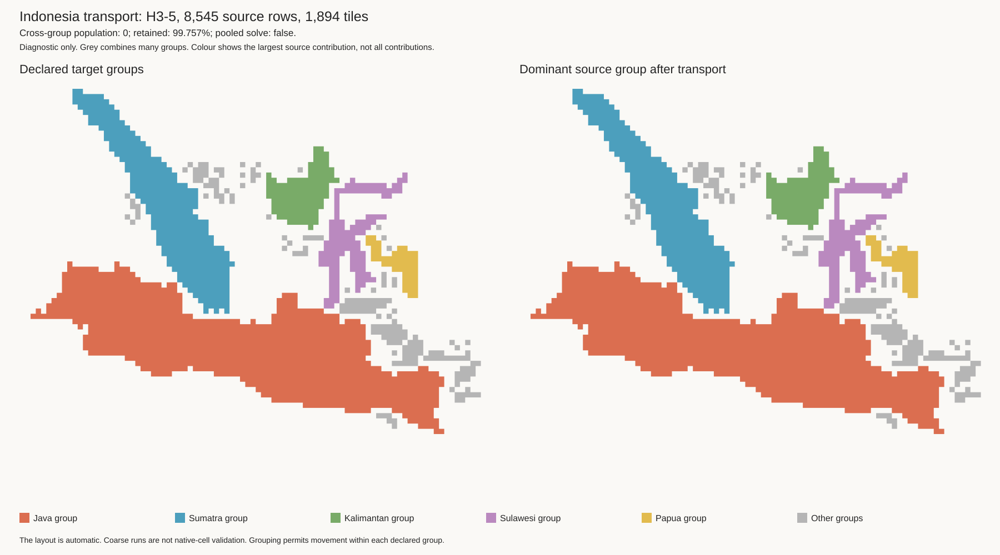
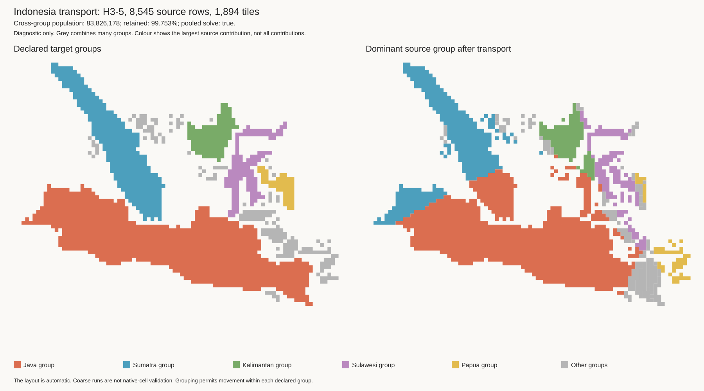
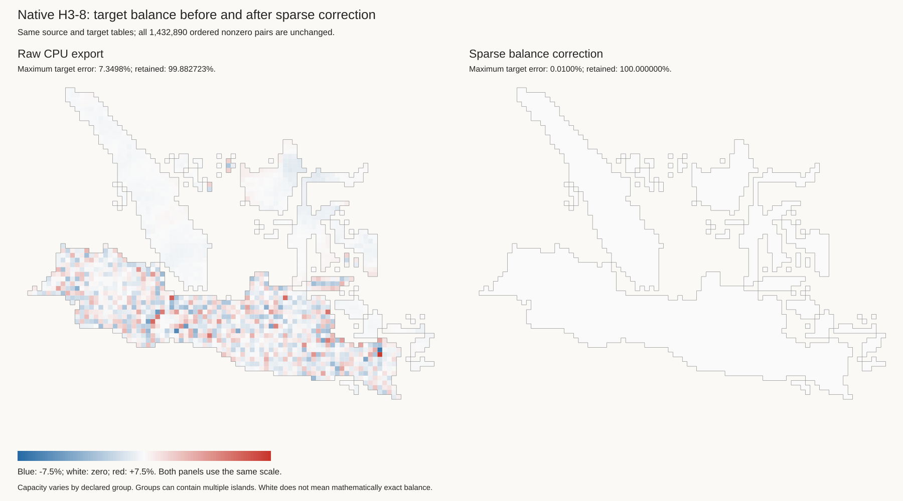

# Island transport results

These tests use the automatic Indonesia layout, not the handmade OWID map.
They test an optional wrapper around the existing CPU solver. Production code
and targets are unchanged.

## What was tested

The matched input has 270,120,945 people. The layout has 1,894 tiles in 51
recorded groups. Small components with no tile budget join another component
in the same country. Thus, a group can contain more than one island.

The grouped wrapper solves each group separately. The pooled comparison solves
all of Indonesia together. Both use the same source rows and target cells.
The wrapper converts north-up layout coordinates to the solver's screen
coordinates and restores north-up coordinates in the export.

H3-3 and H3-5 tests combine native cells by original component and H3 parent.
They use population-weighted projected centres. They do not combine different
component IDs. These are coarse tests, not native H3-8 validation.

| Source resolution | Source rows | Mode | Population sent to a different group | Retained population | Largest target error |
| --- | ---: | --- | ---: | ---: | ---: |
| H3-3 | 619 | Grouped | 0 | 99.606% | 10.813% |
| H3-3 | 619 | Pooled | 83,707,437 | 99.580% | 9.788% |
| H3-5 | 8,545 | Grouped | 0 | 99.757% | 3.865% |
| H3-5 | 8,545 | Pooled | 83,826,178 | 99.753% | 4.522% |
| H3-8 | 832,166 | Grouped | 0 | 99.883% | 7.350% |

The pooled H3-5 result sends about 31% of input population to a different
declared group. This is a measurement for this layout and input, not a general
estimate for Indonesia or the OWID map. The independent CSV checker recomputes
all totals and checks source IDs, target ownership, weights, and duplicate pairs.
All five raw exports pass those checks.

## Native H3-8 grouped transport

The native run takes 8,997 seconds for solves and in-memory checks, excluding
source preparation and file export. It writes 1,432,890 nonzero source-target
pairs. All 832,166 original source IDs occur once in the source table, with
unchanged population and the declared component/group labels. Every source
retains at least 99.5% of its contribution. No population crosses groups.
The raw export omits about 316,791 people in total. Its largest target error,
7.350%, occurs in the Java group.

[Flow checks](results/indonesia-transport-r8-grouped/independent-checks.json) ·
[Native source checks](results/indonesia-transport-r8-grouped/native-source-checks.json) ·
[Target errors](results/indonesia-transport-r8-grouped/target-quality.csv).

This is native-cell validation for the matched input and this automatic layout.
It is not a native pooled comparison, a test of the handmade map, or proof of
complete Indonesian coverage. The separate sparse correction below restores
source totals and reduces the target error on this same export.

## H3-5 grouped transport

[Independent checks](results/indonesia-transport-r5-grouped/independent-checks.json) ·
[Group flows](results/indonesia-transport-r5-grouped/flows.csv) ·
[Target errors](results/indonesia-transport-r5-grouped/target-quality.csv)

## H3-5 pooled comparison

[Independent checks](results/indonesia-transport-r5-pooled/independent-checks.json) ·
[Group flows](results/indonesia-transport-r5-pooled/flows.csv) ·
[Target errors](results/indonesia-transport-r5-pooled/target-quality.csv)

The right panel shows only the largest source-group contribution per tile.
Grey combines many small groups. Read the flow tables for all contributions.
The images alone cannot prove that transport stays within a group.

## Sparse balance correction

A second experiment scales the saved nonzero weights to match source and target
marginals. It does not add source-target pairs. This is separate from the solver
and does not change the original results above.

### Native result

At the strict `1e-8` target tolerance, the native test stops after 50,000
iterations with a relative residual of `2.40e-5`. It does not export an accepted
correction at that tolerance. A new run uses an explicit `1e-4` relative
tolerance, or **0.01%**. This is an experimental limit, not an approved
production requirement.

That run finishes after 26,348 iterations and 513 seconds of scaling:

- Source retention is 100% to floating-point precision.
- Cross-group population remains zero.
- Maximum relative target error is below 0.01%.
- Every native source ID, population, and group label still matches the input.
- An independent comparison confirms that all 1,432,890 ordered source-target
  pairs are unchanged. Only weights change.

[Corrected flow checks](results/indonesia-transport-r8-balanced-grouped/independent-checks.json) ·
[Native source checks](results/indonesia-transport-r8-balanced-grouped/native-source-checks.json) ·
[Support comparison](results/indonesia-native-balance/checks.json) ·
[Corrected target errors](results/indonesia-transport-r8-balanced-grouped/target-quality.csv).

The sum of absolute changes to pair population is 5,105,706. This includes
restored mass and changed distribution within the existing support. It does
not add pairs or cross declared group boundaries. Groups can still contain
multiple islands.

A separate [position-change check](results/indonesia-native-balance/source-shift.json)
compares each source's expected target position. It first normalizes that
source's retained weights, so lost raw mass does not bias the comparison.
The population-weighted mean change is 0.0102 tile sides; the largest change
is 5.482 tile sides. Sources with a change above one tile side contain 0.00552%
of the matched population. These are changes in expected position, not bounds
on each person's movement. Opposite changes can cancel. This check does not
prove absolute geographic accuracy.

### Coarse results

- H3-5 grouped transport reaches full source retention, zero cross-group mass,
  and maximum relative target error below `1e-8` after 34,470 iterations.
  Scaling takes 7.1 seconds, excluding input checks and file export.
  [Independent checks](results/indonesia-transport-r5-balanced-grouped/independent-checks.json).
- H3-3 pooled transport reaches the same target tolerance after 9,848 iterations.
  It still sends 84,105,751 people across groups. Better balance does not fix
  island eligibility.
- H3-3 grouped transport cannot reach that tolerance on its saved support.
  One group has two disconnected support blocks with incompatible capacities.
  They require at least 0.312% maximum relative target error.
- H3-5 pooled transport does not reach `1e-8` within 50,000 iterations. Its
  residual is about `8.47e-7`. This bounded failure is not proof of infeasibility.

This test uses [iterative proportional fitting](https://d-nb.info/1275986811/34).
Convergence depends on the support and requested marginals. The successful
correction changes weights, so spatial quality still needs review. It is not
an excuse to report the uncorrected solver output as fully balanced.

## What this means for issue #17

Separate solves prevent cross-group transport by construction. This result
supports explicit component eligibility, rather than a distance penalty alone.
It does not preserve every small island: the recorded grouping rule still
permits movement between islands in the same group.

There is also a capacity choice. Each group has its own population per tile.
If every tile instead has one exact country-wide population value, the current
integer budgets require at least 1,056,549 people to cross group boundaries.
This lower bound is half the sum of absolute group capacity differences. We
must choose between exact uniform tile capacity, exact integer budgets, and
zero cross-group movement. They cannot all hold for these budgets.

The sparse solver export drops some source contribution. The raw results keep
that loss; only the separate correction changes their weights. Zero cross-group
mass therefore does not imply exact mass retention or equal target values. Target error is measured against each group's
capacity in grouped mode, and the country-wide capacity in pooled mode.

Before production use:

1. Choose and document the capacity rule.
2. Review which islands can share a group and which need an inset or separate tile.
3. Set production limits for source retention and target error; repeat native
   tests for other countries.
4. Resolve unmatched coastal coverage and the missing population year.
5. Integrate group eligibility only after the layout and transport checks pass.

See [generator instructions](generator.md), [layout gallery](gallery.md), and
[work log](work-log.md). Raw mappings remain under ignored `output/`; the saved
results contain small review files and hashes of the complete exports.
